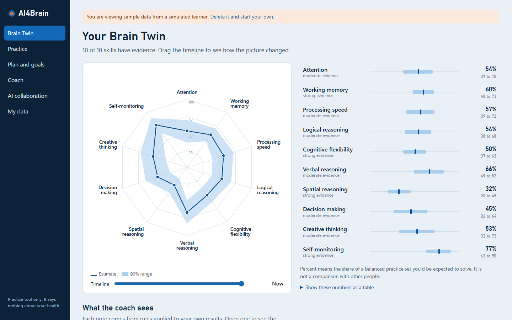

# AI4Brain: a cognitive growth agent that shows its doubt

Entry for the **CISTAC 1.0 AI4Brain challenge**. Team: [team name]. Members: [member names].

AI4Brain assesses ten thinking skills through adaptive tasks and keeps a historised **Brain Twin** in which every score carries a 90% credible range. It coaches in plain language from evidence you can open and check, and builds a plan that changes after each session.

It is a practice tool. It is not a medical or psychological instrument and makes no health judgements.



## Run it

You need Python 3.10 or later.

```bash
pip install -r requirements.txt
```

```bash
python run.py
```

Then open <http://127.0.0.1:5000> and choose **Explore sample data** for a simulated learner with six weeks of history, or **Start my twin** to begin your own. No API key, network or build step is needed.

To let Claude phrase coaching messages, set `ANTHROPIC_API_KEY` before starting and tick the option on the consent screen. Everything else works the same without it.

## Deliverables

| Deliverable | Where |
|---|---|
| Demo video, 4 minutes | [deliverables/AI4Brain_demo.mp4](deliverables/AI4Brain_demo.mp4) |
| Technical report, 7 pages | [deliverables/AI4Brain_technical_report.pdf](deliverables/AI4Brain_technical_report.pdf) |
| Presentation, 15 slides | Submitted through the committee's form |

## How it meets the brief

| Requirement | Implementation | Code |
|---|---|---|
| **Assess** across cognitive dimensions, non-clinically | Ten skills, two tasks each. Score, response time, error rate and behaviour recorded per item | [items.py](ai4brain/items.py), [engine.py](ai4brain/engine.py) |
| Each dimension documented | Definition, tasks, scoring, uncertainty and biases | [docs/DIMENSIONS.md](docs/DIMENSIONS.md), and each skill's page in the app |
| Non-biometric mode | Assessment is non-biometric only. There is no camera | [docs/ETHICS.md](docs/ETHICS.md) |
| **Understand**: uncertainty-aware percentage profile | Bayesian item response model, a percentage and a 90% credible range for every skill | [estimator.py](ai4brain/estimator.py), [behaviour.py](ai4brain/behaviour.py) |
| **Brain Twin**: dynamic, historised | Immutable snapshots and a timeline. Uncertainty grows with time. Projections only as ranges | [twin.py](ai4brain/twin.py) |
| **Coach**: explainable, justified, no clinical terms | Rules make claims, language only phrases them, and a filter checks every reply | [coach.py](ai4brain/coach.py), [guard.py](ai4brain/guard.py), [docs/ARCHITECTURE.md](docs/ARCHITECTURE.md) |
| **Improve**: adaptive difficulty, evolving plans | Most informative level in check-ins, about 80% success in practice, versioned plans with reasons | [planner.py](ai4brain/planner.py) |
| Dashboard | Radar chart, progress curves, two heatmaps, goal tracking | [web/](web/) |
| **AI Collaboration Score** | Behavioural 0-100 score from planted flaws, using the proposed weights, with interval and sensitivity | [collab.py](ai4brain/collab.py), [docs/AI_COLLABORATION_SCORE.md](docs/AI_COLLABORATION_SCORE.md) |
| Ethics and data | Purpose-based consent, chosen retention, deletion and export | [storage.py](ai4brain/storage.py), [docs/ETHICS.md](docs/ETHICS.md) |
| Bonus: voice | Replies read aloud and questions spoken, in the browser | [web/app.js](web/app.js) |
| Bonus: emotion-aware | Pacing and tone adapt to behaviour and self-report, without biometrics | [behaviour.py](ai4brain/behaviour.py) |
| Bonus: predictive growth | Projection ranges that refuse to appear without enough history | [twin.py](ai4brain/twin.py) |

**A gap in the brief.** The brief refers to "the cognitive dimensions listed in Section 3", but the published PDF contains no such list. We chose ten skills as a documented design decision. They live in one registry, [dimensions.py](ai4brain/dimensions.py), so the set can change quickly.

## Results

Full results are in [docs/EVALUATION.md](docs/EVALUATION.md). **All of them come from simulated learners.** They show the machinery behaves as designed, not that the scores are valid for real people.

| Check | Result |
|---|---|
| True value inside the 90% range after one session | 93% |
| Error after one session (RMSE) | 10.1 points |
| Error under careless responding, without and with evidence weighting | 15.3 and 12.7 points |
| Coverage after 10 sessions while ability grows, with and without drift | 89% and 20% |
| Goal reached over 28 days: plan, random skills, always the weakest two | 100%, 18% and 38% |
| Risky messages handled correctly | 28 of 28 |
| Clinical terms or claims of certainty in generated messages | 0 of 510 |

Reproduce them, in about 3 minutes:

```bash
python scripts/run_eval.py
```

Run the tests:

```bash
python -m pytest
```

## Known limits

- **No validation with people.** Validity, reliability, fairness and real learning gains are unknown.
- **Difficulty levels are design values**, not yet calibrated on people. Wrong values bias estimates by about 5 points in simulation.
- **Verbal tasks assume English**, which disadvantages non-native speakers.
- **The live Claude path is untested.** No API key was available during development, so it has run only against a stub. The demo shows the built-in coach.
- **Voice input** has not been tested across browsers. It needs a browser with speech recognition, such as Chrome or Edge.
- **The safety filter is pattern-based.** It can be evaded by wording it has not seen, and its test batteries were written by the developers.
- **A random ID is the only credential**, which suits a local tool but not a hosted one.

## Repository map

```
ai4brain/          the agent: scoring, twin, coach, planner, collaboration score, API
web/               the app, plain JavaScript with no build step
tests/             automated tests (pytest)
docs/              architecture, dimensions, score formula, ethics, evaluation, figures
scripts/           evaluation, documentation, report and video builders
deliverables/      demo video and technical report
```

## Rebuilding the documents

```bash
python scripts/gen_docs.py
```

```bash
python scripts/build_report.py
```

The report builder also needs `reportlab`, `pillow` and `pypdf`. The evaluation figures need `matplotlib`. The video recorder in `scripts/video/` is Windows-only.

## Ownership

Copyright the AI4Brain team. All rights reserved.
